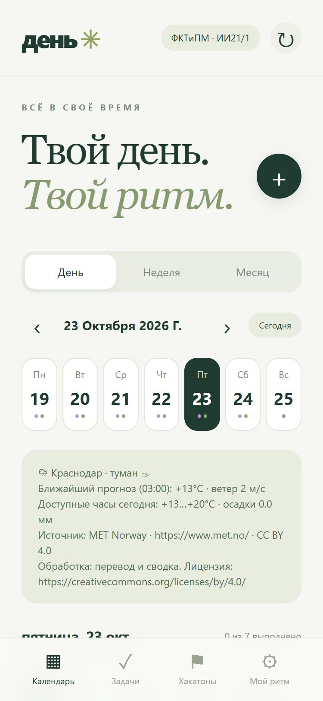
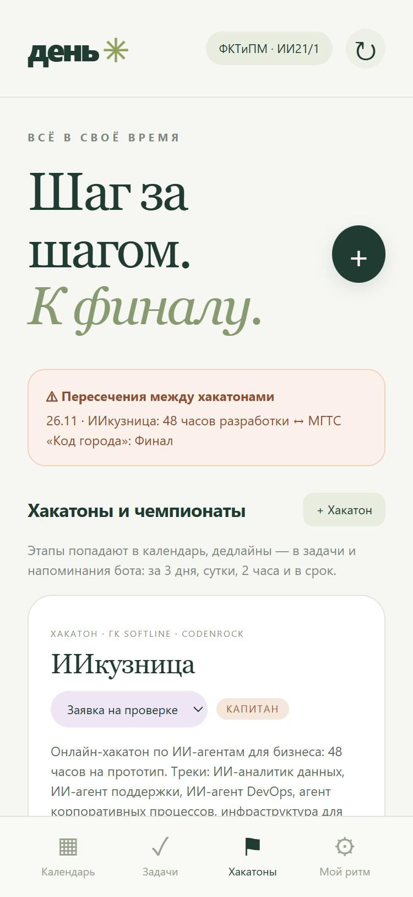
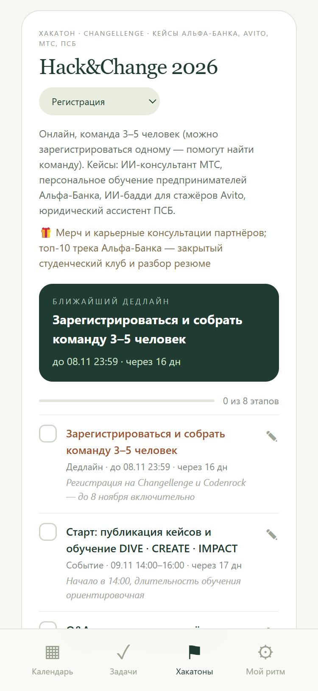
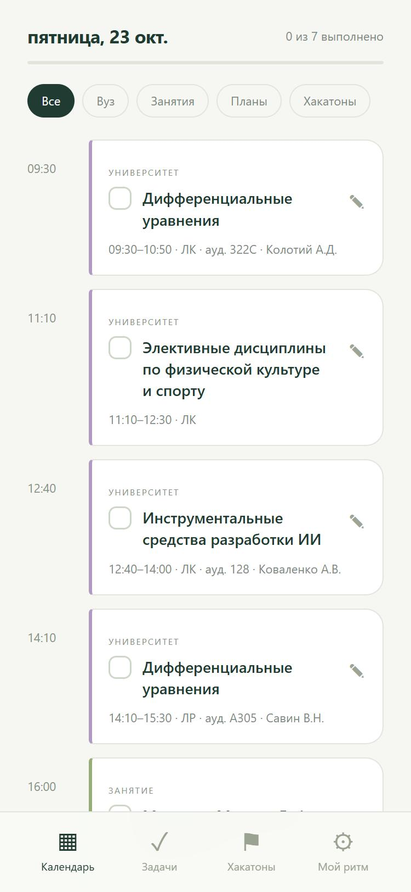
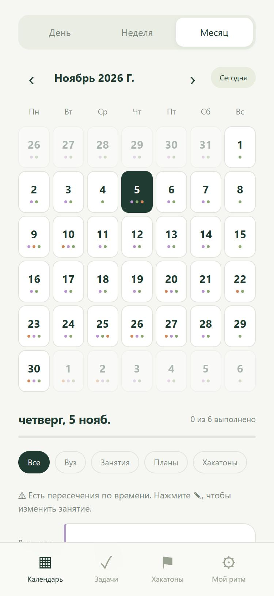
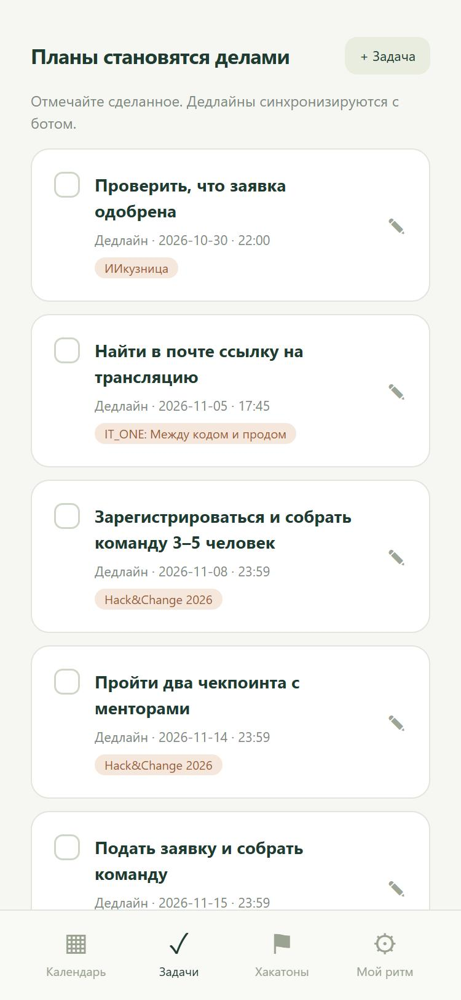
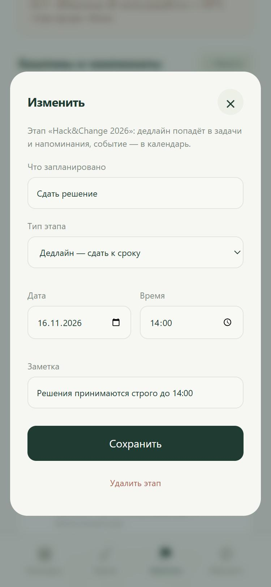
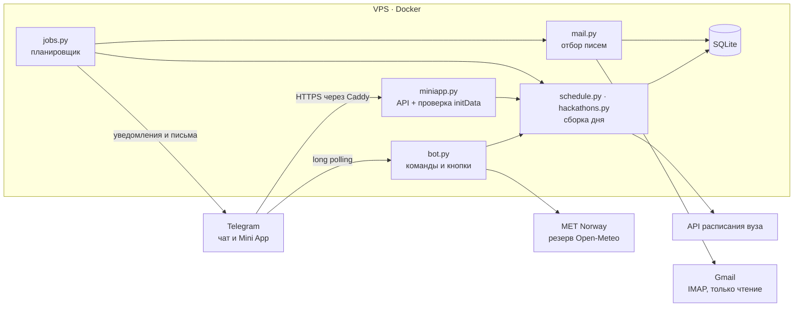

# 📅 Campus Day

**Личный планировщик студента в Telegram: расписание вуза, дополнительные занятия, задачи, хакатоны и погода — в одном боте и Mini App.**

[](https://github.com/MrFerrumL/Days_calendar/actions/workflows/tests.yml)


<p align="center">
  
  &nbsp;
  
  &nbsp;
  
</p>

## О проекте

Студенту приходится держать в голове пары с сайта вуза, дополнительные занятия по двухнедельному циклу, личные дедлайны и несколько хакатонов одновременно. Campus Day собирает всё в одно расписание: утром присылает план дня с погодой Краснодара, напоминает о занятиях и сроках, вечером показывает завтрашний день. Тот же календарь открывается в Telegram как Mini App — с галочками, редактированием и отдельной вкладкой хакатонов.

Бот работает каждый день на собственном VPS: Docker-контейнер за reverse proxy Caddy, под общим доменом с другим моим сервисом. Сделан для группы **ФКТиПМ · 2 курс · ИИ21/1**.

## Ключевые возможности

**📅 Единое расписание из разных источников**
- Пары загружаются из JSON API расписания вуза: аудитории, преподаватели, отмены; об изменениях бот пишет сам.
- Дополнительные занятия — правила с двухнедельным циклом A/B, отмена отдельных дат и личные правки времени.
- Задачи с дедлайнами, блоки времени, разовые и повторяющиеся напоминания, поиск свободных окон, предупреждения о пересечениях.

**🏆 Трекер хакатонов**
- Карточка на каждый хакатон: статус участия, роль, призы, ссылки на кабинеты и лента этапов с обратным отсчётом.
- Этапы трёх типов — дедлайн, событие и многодневное событие — сами попадают в календарь, задачи и напоминания.
- Дедлайны хакатонов напоминают за 3 дня, сутки, 2 часа и в срок; бот находит пересечения этапов разных хакатонов.
- Уже внесены Hack&Change 2026, ИИкузница, МГТС «Код города» и митап IT_ONE с датами с сайтов организаторов.

**🔔 Уведомления по расписанию**
- Утренняя сводка, отдельная погода, план на завтра, напоминания перед занятиями; время и частота меняются командами.
- Учёт отправленного хранится в SQLite: после перезапуска ничего не дублируется, а пропущенное догоняется в окне 10–30 минут.

**📬 Важная почта в чате**
- Бот раз в 3 минуты читает входящие Gmail по IMAP и присылает только важное: личные письма из «Основных», письма по хакатонам, от важных отправителей и с ключевыми словами (заявка, приглашение, дедлайн, результат…).
- Рассылки, спам, письма роботов и заглушённые отправители не приходят; письма остаются непрочитанными в ящике.
- Письмо по хакатону получает кнопку его карточки; под каждым письмом — «Открыть в Gmail» и «Не присылать от домена».
- Коды входа и сброс пароля бот не пересылает целиком; пароль приложения хранится только в `.env` на сервере.

**📱 Telegram Mini App**
- День, неделя, месяц; фильтры по источникам; прогресс выполнения; редактирование занятий, задач, правил и этапов.
- Каждый запрос проверяется HMAC-подписью `initData` Telegram: токен не покидает сервер, по прямой ссылке личные данные не открываются.

**🛡 Надёжность**
- При сбое сайта вуза — кэш нужной недели с пометкой; погода из MET Norway с резервом Open-Meteo.
- 92 автотеста без сети и токена, включая поддельный IMAP-сервер; CI на Linux и Windows для Python 3.11–3.13.

## Скриншоты

| Пары дня | Месяц | Задачи | Редактор этапа |
|:---:|:---:|:---:|:---:|
|  |  |  |  |
| Аудитории и преподаватели из API вуза | Точки: вуз, занятия, хакатоны | Дедлайны с меткой хакатона | Дедлайн, событие или несколько дней |

Скриншоты сняты на демонстрационной базе: пары и погода — живые данные на 23.10.2026, хакатоны — из [data/hackathons.json](data/hackathons.json).

## Как это выглядит в чате

`/hack` — сводка по всем хакатонам:

```text
🏆 Хакатоны и чемпионаты · активных: 4

ИИкузница · Заявка на проверке
⏭ Проверить, что заявка одобрена — до 30.10 22:00 · через 7 дн
▱▱▱▱▱▱▱▱ 0/6

Hack&Change 2026 · Регистрация
⏭ Зарегистрироваться и собрать команду 3–5 человек — до 08.11 23:59 · через 16 дн
▱▱▱▱▱▱▱▱ 0/8

⚠️ Пересечения между хакатонами
26.11 · ИИкузница: 48 часов разработки ↔ МГТС «Код города»: Финал
```

Напоминание за трое суток до дедлайна и блок утренней сводки:

```text
🏆 Hack&Change 2026 · дедлайн через 72 ч · #5
Сдать решение
16.11 14:00
Решения принимаются строго до 14:00
```

```text
🏆 Скоро по хакатонам
до 05.11 17:45 · IT_ONE: Между кодом и продом — Найти в почте ссылку на трансляцию · завтра
05.11 18:00–20:10 · IT_ONE: Между кодом и продом — Митап: персональный ИИ и Helm-чарты · завтра
до 08.11 23:59 · Hack&Change 2026 — Зарегистрироваться и собрать команду 3–5 человек · через 4 дн
```

## Технологии

| Область | Решение |
|---|---|
| Язык | Python 3.11+, `asyncio`; только стандартная библиотека и `tzdata` |
| Telegram | Bot API через `urllib`: long polling, inline-кнопки, редактирование сообщений на месте, разбиение длинных текстов по UTF-16 |
| Почта | `imaplib` по TLS в режиме только чтения, категория «Основные» через `X-GM-RAW`, разбор MIME и HTML в текст, позиция ящика по UIDVALIDITY/UID |
| Mini App | HTML, CSS и JavaScript без сборки и фреймворков; JSON API на `ThreadingHTTPServer` |
| Данные | SQLite в режиме WAL, миграция схемы при запуске, начальные данные из JSON без перезаписи правок |
| Безопасность | HMAC-SHA256 проверка `initData`, доступ только владельцу, ответы plain text без HTML-инъекций, секреты не попадают в логи |
| Инфраструктура | Docker Compose, Caddy reverse proxy под общим доменом, автоперезапуск после сбоев и перезагрузки |
| Качество | 92 теста `unittest`, GitHub Actions: 2 ОС × 3 версии Python |

## Архитектура



## Возможности подробно

### Telegram Mini App

В личном чате нажмите **«Календарь»** слева от строки сообщения или отправьте `/app`. Приложение использует ту же базу, что и бот.

- **День:** занятия, погода, фильтры «Вуз / Занятия / Планы / Хакатоны», прогресс выполнения.
- **Неделя:** расписание всех семи дней одним списком.
- **Месяц:** календарная сетка с индикаторами событий; нажатие на дату открывает её расписание ниже.
- **Галочки:** можно отметить и снять выполнение любого занятия; отметки сохраняются в SQLite. Для отмеченного события автоматические напоминания отключаются, пока галочка стоит.
- **Задачи:** создание, редактирование дедлайна, выполнение и возврат в работу. Дедлайны хакатонов помечены названием хакатона.
- **Хакатоны:** карточка на каждый хакатон или чемпионат — статус участия, роль, призы, ссылки на кабинеты, ближайший этап с обратным отсчётом и лента этапов с галочками. Этапы бывают трёх типов: дедлайн, событие со временем и событие на несколько дней. Вверху — предупреждение, если этапы разных хакатонов пересекаются.
- **✎ на занятии:** личное изменение названия и времени в пределах выбранного дня, отмена и возврат исходного расписания. Вузовский сайт при этом не меняется. Изменения хранятся отдельно от кэша и не теряются при обновлении сайта.
- **«Мой ритм»:** настройка уведомлений, изменение и добавление повторяющихся занятий, дней и цикла A/B.

Авторизация на каждом API-запросе проверяет HMAC-подпись `Telegram.WebApp.initData`, владельца и возраст сессии (до часа). Бот-токен никогда не передаётся браузеру. Прямой вход по URL без Telegram не открывает личные данные.

#### HTTPS для Mini App

Mini App требует HTTPS. В текущей локальной установке используется **временный Cloudflare Quick Tunnel** до `127.0.0.1:8765`. Он работает, пока включён компьютер и запущены бот и туннель. `start-bot.cmd` запускает оба процесса и обновляет кнопку Telegram, если установлен `runtime/tools/cloudflared.exe`; `stop-bot.cmd` останавливает оба.

При новой установке Windows скачайте официальный клиент:

```powershell
New-Item -ItemType Directory -Force runtime\tools
Invoke-WebRequest https://github.com/cloudflare/cloudflared/releases/latest/download/cloudflared-windows-amd64.exe -OutFile runtime\tools\cloudflared.exe
```

Затем запустите `start-bot.cmd`. Временный адрес меняется при перезапуске туннеля; скрипт автоматически привязывает новый адрес через `connect_miniapp.py`. Старое окно Mini App после этого нужно закрыть и открыть заново. Quick Tunnel подходит для личного тестирования и не гарантирует доступность.

Для постоянной установки нужен стабильный HTTPS-адрес с reverse proxy к серверу приложения. Укажите `MINI_APP_URL=https://ваш-домен` в `.env` и выполните `python connect_miniapp.py`, чтобы обновить кнопку. В Docker порт доступен только на localhost хоста; привязка кнопки: `docker compose exec bot python connect_miniapp.py`. Хранение токена и базы остаётся на сервере бота.

Интерфейс проверен в браузере на отдельной тестовой базе: переключение видов, сохранение галочки и редактирование времени занятия. Аутентификация и редактирование дополнительно проверяются автоматическими тестами.

| Функция | Что делает |
|---|---|
| 🎓 Вуз | Загружает пары из [cube.nlabs.su](https://cube.nlabs.su/timetable?type=group), включая аудитории, преподавателей и отмены |
| 📚 Дополнительные занятия | Двухнедельный цикл занятий, лекции и «Мигалок», каждое по 2 часа |
| 📅 План дня | Показывает погоду → вуз → дополнительные занятия → личные планы → дедлайны |
| 🔔 Уведомления | Сводки на сегодня и завтра, отдельная погода, напоминания перед занятиями |
| 🎯 Задачи | Дедлайны с напоминаниями за 24 часа, 2 часа и в момент срока; завершение и перенос кнопками |
| 🗓 Планы | Блоки времени с произвольной длительностью, включённые в расписание и уведомления |
| 🔁 Регулярность | Ежедневные и еженедельные напоминания; занятия каждую неделю либо через неделю |
| 🕊 Свободные окна | Ищет интервалы нужной длины с 08:00 до 23:00, учитывает пересечения |
| ⚠️ Конфликты | Предупреждает, если занятия или планы пересекаются |
| 🍅 Фокус | Таймер занятия или работы с уведомлением о перерыве |
| 🏆 Хакатоны | Этапы, статусы и ссылки хакатонов; дедлайны с напоминанием за 3 дня, пересечения между хакатонами |
| 📬 Почта | Важные письма Gmail в чат: «Основные», хакатоны, важные отправители и ключевые слова; рассылки и спам отсекаются |
| 💾 Сохранение | SQLite хранит задачи, настройки, исключения, кэш и отправленные уведомления |

Обычный день выглядит так (пример без блока погоды):

```text
📅 22.10.2026 · четверг · неделя A

🎓 Вуз · ИИ21/1
весь день · КСРС

📚 Занятия
14:00–16:00 · Занятие · Абдурахманов П. / Данил З
16:00–18:00 · Мигалка · Ширнаев Н. / Токаев И.
18:00–20:00 · Занятие · Глухова Д. / Хилько Н.
20:00–22:00 · Занятие · Прокофьев Д. / Товмасян Н.
```

## Быстрый запуск

### Текущее серверное размещение

Mini App: **https://infocode1.ru/calendar/**. Код находится в `/opt/campus-day-bot`, данные — в `/opt/campus-day-bot/runtime/bot.sqlite3`. Сервис `campus-day-bot` подключён к существующей Docker-сети `infocode_default`; маршрут `/calendar/*` в Caddy направляет запросы к нему, остальные страницы продолжают обслуживаться платформой ЕГЭ.

```bash
cd /opt/campus-day-bot
sudo docker compose -f compose.server.yaml up -d --build
sudo docker compose -f compose.server.yaml logs --tail=50 bot
```

`restart: unless-stopped` и включённый Docker обеспечивают запуск после перезагрузки VPS. Локальный запуск Windows блокируется маркером `runtime/server-deployment.json`, чтобы не создавать второй polling-процесс. Не запускайте локальную и серверную копии одновременно.

Бэкап исходной конфигурации Caddy хранится в `/opt/campus-day-bot/deploy-backups/`. При обновлении платформы ЕГЭ сохраняйте маршрут `/calendar/*`. Клиент использует относительные адреса ресурсов и API, поэтому работает под этим префиксом.

При недоступности Telegram на старте HTTP-сервер Mini App продолжает работать, бот повторяет соединение каждые 30 секунд. Для сообщений и напоминаний серверу нужен исходящий HTTPS-доступ к `api.telegram.org`. Прямой доступ к данным без подписанного Telegram initData закрыт.

Нужны Python **3.11+**, интернет и токен Telegram. Платные API и ключ для погоды не нужны.

### 1. Скачать проект и установить зависимости

```bash
git clone https://github.com/MrFerrumL/Days_calendar.git
cd Days_calendar
python -m venv .venv
```

Windows PowerShell:

```powershell
.\.venv\Scripts\Activate.ps1
python -m pip install -r requirements.txt
Copy-Item .env.example .env
```

Linux / macOS:

```bash
source .venv/bin/activate
python -m pip install -r requirements.txt
cp .env.example .env
```

Если PowerShell ограничивает запуск скриптов, активация не обязательна: используйте `.\.venv\Scripts\python.exe` вместо `python`.

### 2. Получить токен

Откройте [@BotFather](https://t.me/BotFather), отправьте `/newbot` и следуйте его подсказкам. Скопируйте выданный токен в локальный файл `.env`:

```dotenv
BOT_TOKEN=сюда_токен_от_BotFather
OWNER_ID=
TIMEZONE=Europe/Moscow
```

Токен хранится локально. Файлы `.env`, база и папка `runtime/` исключены из Git.

### 3. Привязать личный Telegram

```bash
python -m campus_bot
```

Откройте своего бота и отправьте `/id`. Полученное число запишите в `OWNER_ID` файла `.env`. Остановите процесс через `Ctrl+C`, запустите снова и отправьте боту `/start`.

До заполнения `OWNER_ID` доступны только подсказка запуска и `/id`. Читать расписание и управлять планами может только владелец в личном чате. Привязка к первому случайному посетителю не используется.

**Запуск на Windows двойным щелчком:** после заполнения `.env` откройте `start-bot.cmd`. Бот запускается в фоне; окно можно закрыть. `stop-bot.cmd` останавливает именно этот экземпляр. Журналы находятся в `runtime/stdout.log` и `runtime/stderr.log`. После изменения `.env` выполните остановку и запуск. Скрипт использует Python из `.venv` или системный Python; автоматический запуск после перезагрузки компьютера не включается.

### 4. Проверить источники без Telegram-токена

```bash
python -m campus_bot --check
python -m campus_bot --preview 2026-10-22
```

`--check` запрашивает реальные сайт и погоду, печатает результат и возвращает ненулевой код при сбое. `--preview` показывает день в терминале. Эти команды используют ту же базу, поэтому запускайте их, когда основной процесс остановлен.

## Настройки регулярности

По умолчанию используется **Москва / Краснодар, UTC+3**:

| Настройка | По умолчанию | Пример изменения |
|---|---|---|
| План на сегодня | 07:30 ежедневно | `/set digest 07:30,13:00` |
| Погода отдельно | 08:00 ежедневно | `/set weather 08:00,16:00` |
| План на завтра | 21:00 ежедневно | `/set evening 21:00` |
| Напоминания о занятии/плане | За 30 и 10 минут | `/set alerts 60,15` |
| Проверка расписания вуза | Каждые 180 минут | `/set sync 60` |
| Начало недели A | 19.10.2026 | `/set anchor 2026-10-19` |

До 6 отправок каждого типа в день; до 5 интервалов напоминаний (1–1440 минут). Обновление вуза — от 15 до 1440 минут. Время вводится в формате `ЧЧ:ММ`, без пробелов внутри списка.

`/set weather off`, `/set digest off`, `/set evening off`, `/set alerts off` выключают выбранный тип уведомлений. `/pause` выключает все автоматические сообщения, `/resume` включает их. `/stop` отписывает; `/start` возвращает подписку. При паузе команды продолжают работать.

## Основные команды

| Команда | Назначение |
|---|---|
| `/today`, `/tomorrow` | Сегодня / завтра |
| `/day 2026-11-02` | Конкретная дата |
| `/week` | Ближайшие семь дней |
| `/next` | Текущее и следующее занятие в ближайшие семь дней |
| `/free завтра 60` | Свободные интервалы от часа |
| `/weather` | Погода на сегодня в Краснодаре |
| `/sync` | Обновить текущую и следующую неделю |
| `/group 1` / `/group 2` | ИИ21/1 / ИИ21/2 |
| `/settings`, `/help` | Настройки и все команды |

Даты — `ГГГГ-ММ-ДД`. В командах с датой также можно писать `сегодня` и `завтра`.

### Задачи, планы и напоминания

```text
/add 2026-11-02 23:59 Сдать лабораторную по Python
/plan 2026-11-02 15:00 60 Подготовиться к зачёту
/remind 2026-11-02 18:00 Купить тетради
/remind daily 09:00 Выпить воды
/remind weekly mon 10:00 Проверить дедлайны
/focus 25 Математический анализ
```

`/add` создаёт дедлайн; он не занимает время в поиске свободных окон. `/plan` создаёт блок времени (длительность в минутах, 5–1440), который учитывается в окнах и конфликтах. `/remind` создаёт отдельное сообщение. `/focus` запускает таймер на 1–180 минут.

```text
/tasks
/reminders
/done 3
/move 3 2026-11-03 18:00
```

В списках есть кнопки завершения и переноса на час, а также страницы по шесть записей. `/done` закрывает задачу, отключает напоминание или убирает личный план. Перенос повторяющегося напоминания меняет его время и опорный день. Завершённое разовое напоминание автоматически убирается из активных; просроченные задачи остаются до завершения.

### Регулярные занятия и исключения

```text
/lesson list
/lesson add mon,wed 17:00 120 all Моё занятие
/lesson add fri 16:00 120 a Мигалка
/lesson delete custom-xxxxxxxx
/skip 2026-11-02 mon18
/unskip 2026-11-02 mon18
```

Дни: `mon tue wed thu fri sat sun`. Цикл: `all` — каждую неделю, `a` / `b` — через неделю. `/skip` отменяет только одну дату по ID из `/lesson list`; правило продолжает действовать в остальные дни. Эти команды меняют дополнительные занятия, вузовские пары загружаются с сайта.

### Хакатоны

```text
/hack
/hack hackchange
/hack new alfa Alfa-Hack 2026
/hack alfa task 2026-11-16 14:00 Сдать решение
/hack alfa event 2026-11-09 14:00 120 Старт кейса
/hack alfa day 2026-11-22 Финал
/hack alfa link https://example.com Кабинет
/hack alfa status submitted
```

`/hack` (кнопка «🏆 Хакатоны») показывает активные хакатоны, ближайший этап каждого, прогресс и пересечения между ними. В карточке хакатона кнопки отмечают этапы и переключают статус, сообщение обновляется на месте. Статусы: `registration`, `review`, `accepted`, `active`, `submitted`, `final`, `done`, `dropped`.

Дедлайн хакатона — обычная задача с привязкой: он виден в `/tasks`, в плане дня и напоминает **за 3 дня, сутки, 2 часа и в срок** (остальные задачи — за сутки, 2 часа и в срок). События хакатона попадают в календарь и получают обычные напоминания перед началом. Утренняя сводка показывает блок «Скоро по хакатонам» на две недели вперёд. Статус «Не участвую» убирает этапы из календаря, задач и напоминаний, не удаляя их.

Стартовые хакатоны лежат в [data/hackathons.json](data/hackathons.json): Hack&Change 2026, ИИкузница, МГТС «Код города» и митап IT_ONE — даты взяты с сайтов организаторов, Codenrock и личных кабинетов 23.10.2026. Каждый хакатон из файла добавляется в базу один раз; изменения и удаления в боте при перезапуске не перезаписываются. Новый хакатон в файле появится после следующего запуска.

### Почта

**Подключение Gmail.** Нужен не обычный пароль, а пароль приложения:

1. Включите двухэтапную проверку в аккаунте Google.
2. Создайте пароль приложения на [myaccount.google.com/apppasswords](https://myaccount.google.com/apppasswords).
3. Допишите в `.env` рядом с ботом (на сервере — `/opt/campus-day-bot/.env`):

   ```dotenv
   MAIL_USER=адрес@gmail.com
   MAIL_PASSWORD=abcd efgh ijkl mnop
   ```

4. Перезапустите бота. Первая проверка только запоминает текущее место в ящике и пишет «Почта подключена» — старые письма не присылаются.

Для других почтовых сервисов с IMAP укажите `MAIL_IMAP_HOST`, например `imap.yandex.ru`; категория «Основные» есть только у Gmail, в остальных ящиках рассылки отсекаются по заголовкам `List-Unsubscribe`, `List-Id` и `Precedence`.

```text
/mail
/mail check
/mail vip example.com
/mail mute news@shop.ru
/mail unvip example.com
/mail unmute shop.ru
/mail off
/mail on
/set mail 5
```

**Что приходит в чат.** Письмо пересылается, если выполняется одно из условий: тема или отправитель связаны с хакатоном из `/hack` (по названию или домену его ссылок), отправитель в списке важных (Codenrock, Changellenge, Softline, МГТС, IT_ONE, КубГУ и добавленные через `/mail vip`), в теме есть ключевое слово (хакатон, дедлайн, заявка, регистрация, приглашение, собеседование, стажировка, результат, расписание, экзамен…) или это личное письмо из «Основных» без признаков рассылки. Не приходят спам (папку «Спам» бот не читает), письма роботов вроде `mailer-daemon` и отправители из `/mail mute`; заглушение сильнее списка важных.

**Как выглядит сообщение.** Отправитель, тема, время получения, причина («хакатон «Hack&Change 2026»», «важный отправитель», ««Основные»») и первые ~700 символов текста: HTML переводится в текст, цитаты прошлой переписки и длинные трекинговые ссылки убираются. Кнопки: «Открыть в Gmail», карточка хакатона и «🔕 Не присылать от домена». Для писем с кодами входа и сбросом пароля текст не пересылается.

**Надёжность.** Ящик открывается только для чтения (`SELECT … readonly`, `BODY.PEEK`), флаги писем не меняются. Позиция хранится как UIDVALIDITY и последний UID: после перезапуска ничего не повторяется, при смене ящика бот заново запоминает позицию без пересылки старого. За одну проверку — не больше 10 писем, остальные сводятся в одно сообщение. Если Telegram не принял письмо, следующая проверка начнёт с него. Неверный пароль бот сообщает один раз; сетевые сбои молча повторяются. Пауза `/pause` останавливает и почту, «Мой ритм» в приложении содержит переключатель «Важные письма в чат».

## Расписание дополнительных занятий

В расписание входят **все** занятия, «Мигалки» и лекция; цикл недель такой:

- **A:** 19–25 октября 2026, затем 2–8 ноября и далее через неделю.
- **B:** 26 октября – 1 ноября 2026, затем 9–15 ноября и далее через неделю.
- Каждое дополнительное занятие длится **120 минут**. Для вузовских пар сохраняется фактическое время API, обычно 80 минут.

В [data/personal_schedule.json](data/personal_schedule.json) — **28 правил**, дающих 22 события на неделе A и 21 на неделе B. По пятницам недели B учтён сдвиг на 14:30 / 16:30 / 18:30. Воскресная лекция начинается в 10:00 и заканчивается в 12:00.

JSON используется при первом запуске новой базы. После этого правила сохраняются в SQLite и редактируются через бота; удалённое правило не возвращается при перезапуске. Начало цикла можно изменить командой `/set anchor`. Дата должна быть понедельником. До начала цикла дополнительные занятия не генерируются. Цикл продолжается до ручного изменения: каникулы и завершение курса нужно задавать исключениями или удалением правил.

## Работа 24/7 через Docker

На компьютере или сервере с Docker заполните `.env`, затем:

```bash
docker compose up -d --build
docker compose logs -f --tail=100
```

Бот автоматически перезапускается; база находится в постоянном томе `bot-data`. Для остановки — `docker compose down`. Данные в томе сохраняются. Обновление после `git pull` — снова `docker compose up -d --build`.

Процессу не нужен открытый входящий порт: используется Telegram long polling. Одновременно должен работать один экземпляр с одним токеном. Локальная блокировка предотвращает запуск двух процессов с одной папкой данных.

**GitHub хранит код, а работающий компьютер или сервер запускает бота.** После выключения компьютера бот не присылает сообщения. Для круглосуточной работы оставьте процесс на постоянно включённом устройстве.

Если у токена уже настроен webhook другого приложения, обычный запуск сообщит об этом. Явный переход на polling:

```bash
python -m campus_bot --delete-webhook
python -m campus_bot
```

## Источники и устойчивость

- **Вуз:** публичный JSON API веб-приложения `https://api.cube.nlabs.su/api/timetable/lessons/viewer?group=2491&start_date=...&end_date=...`. Группа `2491` — ИИ21/1, `2492` — ИИ21/2, подтверждено 22.10.2026. Формат API неофициальный и может измениться. Группа проверяется в каждой полученной записи. Получение календарных дат позволяет учитывать реальные отмены без самостоятельного вычисления чётности вуза.
- **Погода:** [MET Norway Locationforecast](https://api.met.no/weatherapi/locationforecast/2.0/documentation), резерв — [Open-Meteo](https://open-meteo.com/en/docs), координаты Краснодара `45.0355, 38.9753`. MET показывает ближайший модельный прогноз и диапазон **доступных часов** сегодняшнего дня; прошедшие часы могут отсутствовать. Данные кэшируются минимум на 30 минут с учётом HTTP `Expires`. Источник и лицензия указаны в сообщении. См. [THIRD_PARTY.md](THIRD_PARTY.md).
- При сбое вуза показывается кэш **только нужной недели и группы**, с датой обновления. Если кэша нет, бот явно сообщает об отсутствии данных; свободные окна в таком случае требуют проверки.
- Ошибка погоды не блокирует расписание. Если оба источника не отвечают, бот использует кэш текущего дня с пометкой либо сообщает о недоступности.
- Обычные напоминания догоняются в течение **10 минут**, сводки — в течение **30 минут** после назначенного времени. При более долгом простое старые сообщения не рассылаются пачкой. Дедлайны при этом остаются в плане дня.
- Планировщик проверяет задания каждые 20 секунд. Записи об отправке сохраняются после успешного ответа Telegram. При аварии ровно между ответом Telegram и записью в базу возможен повтор: строгая доставка exactly-once через Bot API не гарантируется.
- Входящие команды принимаются с сохранением Telegram offset до выполнения, чтобы сбой ответа не создавал задачу повторно. Авария в момент выполнения может потребовать повторить команду; созданные записи видны в `/tasks`.
- При HTTP 429 отправка уведомления повторяется с задержкой; после блокировки бота пользователем автоподписка отключается.
- Тексты отправляются без интерпретации HTML/Markdown. Групповые чаты и команды посторонних не получают доступ к данным владельца.

## Устройство проекта

```text
campus_bot/
  __main__.py    CLI, блокировка процесса, запуск
  bot.py         команды, кнопки, проверка владельца
  schedule.py    API вуза, двухнедельный цикл, кэш
  weather.py     MET Norway + резерв Open-Meteo
  jobs.py        планировщик и учёт отправленных уведомлений
  storage.py     SQLite
  models.py      события, интервалы, пересечения
  views.py       тексты сообщений и меню
  hackathons.py  этапы хакатонов, обратный отсчёт, пересечения, карточки
  mail.py        IMAP только для чтения, отбор важных писем, текст для чата
data/
  personal_schedule.json
  hackathons.json
tests/
  test_bot.py
  test_hackathons.py
  test_mail.py   поддельный IMAP-сервер
  fixtures/      примеры реальных ответов API
```

Прикладной код использует стандартную библиотеку Python. Единственная устанавливаемая зависимость — `tzdata` для часовых поясов на Windows. Секреты не записываются в URL журналов; дампы сообщений пользователя в лог не попадают.

### Проверки

```bash
python -m compileall -q campus_bot
python -m unittest discover -s tests -v
```

Тесты работают без токена и интернета: проверяют обе недели, длительности, переход месяца, КСРС без времени, отмены, кэш, сбои API, пересечения, переход через полночь, регулярные уведомления, права владельца, дедупликацию, сохранение после перезапуска, резервный источник погоды, а также хакатоны: загрузку стартовых данных, миграцию старой базы, многодневные события, напоминания за 3 дня, пересечения, команды `/hack` и API приложения; почту: отбор писем, очистку текста, первую проверку без пересылки старого, повтор после сбоя Telegram, ограничение потока, ошибку входа и режим только чтения. GitHub Actions запускает их на Linux и Windows с Python 3.11–3.13.

### Резервное копирование

Остановите бот и сохраните файл `runtime/bot.sqlite3` (или базу из Docker-тома). Для восстановления верните его в папку `DATA_DIR`. Рабочую SQLite-базу нельзя копировать отдельно от WAL во время записи: сначала остановите процесс или используйте SQLite backup API.

При смене токена сохраните базу для сохранения планов, но сбросьте Telegram offset в ней:

```bash
python -m campus_bot --reset-offset
```

Перед командой остановите процесс. Команда использует папку `DATA_DIR` из настроек и не меняет планы.
